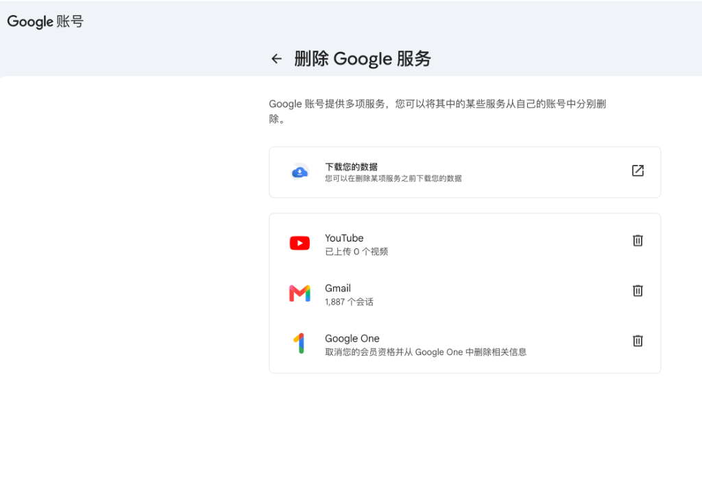

# Google 地区助手

一款 Chrome / Edge 浏览器扩展（Manifest V3），用于快速查看 Google 多账号当前关联地区，并在地区更改页面一键预填目标国家或美国免税州（仅辅助填充，需人工核对后手动提交）。

## 解决的痛点

- **多账号归属地区难核对**：浏览器登录多个 Google 账号时，难以一眼看清各账号当前归属地区，只能逐个切号点进修改页确认。
- **修改入口隐蔽、直达不便**：地区修改表单入口藏得较深，切换不同账号槽位往往需要反复切换或手动拼链接。
- **原生列表超长且不支持搜索**：国家（254 项）与美国州/子地区（51 项）均为纯滚动下拉，不支持关键词或缩写代码检索，寻找俄勒冈、特拉华等免税州尤为费时。
- **高频选区重复操作繁琐**：每次更改美区或常用地区都要分步找国家、等子地区加载再找州，缺乏一键直选入口。

## 功能特性

- **多账号识别**：自动识别当前浏览器已登录的 Google 账号及各自关联地区，支持按国家区分彩色标签与一键直达。
- **双 Tab 协同操作**：顶部共享多账号选择器，弹窗分为「地区修改」与「快捷入口」两个标签页，选定账号后可在两个页面无缝使用同一账号上下文。
- **双端一致选区**：支持扩展弹窗（Popup）与修改页右侧悬浮面板双端操作，均具备常用国家/美国免税州快捷按钮及全球地区搜索。
- **全量搜索与键盘流**：内置全部 254 个国家/地区与 51 个美国子地区，支持中英文及代码搜索，支持方向键、回车与 `Esc` 快捷选择。
- **外语页面 100% 准确选中**：兼容英文等外语版本的 Google 地区修改页，选区、回显与默认原因兜底均准确适配。
- **安全边界**：自动填充目标地区（未选原因时默认兜底「我在过去一年内搬到了这里」），**绝不自动提交表单**。
- **亮暗模式适配**：遵循系统主题自动切换 Google Material 3 浅色/深色外观。

## 功能详解

### 1. 全局账号栏（顶部共享）

- 打开弹窗后自动扫描当前浏览器登录的 Google 账号槽位（`/u/0` - `/u/9`），展示邮箱地址、默认标签及当前归属地区彩色标签。
- 切换上方选中的账号后，无论是「地区修改」还是「快捷入口」Tab，都会直接针对该账号打开对应页面（无需每次手动切号）。

### 2. Tab 1：地区修改

- **美国免税州 / 常用国家快捷按钮**：一键选中俄勒冈（OR）、特拉华（DE）、蒙大拿（MT）、新罕布什尔（NH）、阿拉斯加（AK）等免税州，以及美、日、港、台、英、新等常用地区。
- **全量地区搜索**：支持按中文名、英文名或两字母代码实时检索全部 254 个国家/地区与 51 个美国子地区。
- **打开并自动填充 / 仅打开页面**：若当前标签页已停留在目标账号的修改页，直接原地填表；否则新开对应账号的 `country-association-form` 页面并在加载完成后自动预填目标地区与默认搬迁原因（**不自动点提交**）。
- **页面右侧悬浮面板**：在 `policies.google.com` 地区修改页同步注入轻量悬浮面板，支持页面内随时重选地区并立即填充。

### 3. Tab 2：快捷入口

按当前上方选中的 Google 账号槽位，直接打开对应的高频账单与账号管理页面：

| 分组 | 入口名称 | 对应页面与功能说明 |
| :--- | :--- | :--- |
| **账单与订阅** | **付款资料首页** | 打开 `pay.google.com/payments/u/{i}/home`，管理付款方式、银行卡、账单地址及历史交易记录。 |
| **账单与订阅** | **付款资料设置** | 直达 `pay.google.com/payments/u/{i}/home#settings`，查看付款资料国家/地区、ID 或在换区前关闭旧付款资料。 |
| **账单与订阅** | **Google Play 订阅管理** | 打开 `play.google.com/store/account/subscriptions?authuser={i}`，查看或取消 Play 商店中的自动续费订阅与历史订单。 |
| **账单与订阅** | **Google One 设置** | 打开 `one.google.com/u/{i}/settings`，管理会员方案、家庭共享或取消 Google One 订阅。 |
| **优惠与账号管理** | **学生优惠入口** | 打开 `one.google.com/u/{i}/ai-student`，查看 Google One / Gemini 学生认证活动及优惠资格。 |
| **优惠与账号管理** | **删除 Google 服务** | 打开 `myaccount.google.com/u/{i}/deleteservices`，进入当前账号的单项服务管理页（**详细安全说明见下文**）。 |

#### 关于「删除 Google 服务」的安全说明

点击「删除 Google 服务」后，Google 会先要求你进行一次密码或通行密钥（Passkey）身份验证。**验证通过后并不会立即删除任何数据或服务**，只会进入如下服务管理列表页：

- 页面顶部提供 **「下载您的数据」** 入口，可按需先备份资料。
- 列表展示当前账号下可单独移除的单项服务（如 YouTube、Gmail、Google One 等），若不操作直接关闭网页不会产生任何影响。
- **只有手动点击某一项服务右侧的垃圾桶图标，并完成页面二次确认后**，Google 才会取消或移除对应的那一项服务（例如单独取消会员并删除 Google One 相关信息，不会删除整个 Google 账号；注意误删 Gmail 将导致该邮箱地址永久停用）。



## 项目架构

```text
google-region-helper/
├── manifest.json       # 扩展清单与权限配置
├── popup.html          # 扩展弹窗页面
├── popup-theme.css     # 弹窗亮/暗主题与标签配色
├── popup.css           # 弹窗布局与控件样式
├── popup-tabs.css      # 弹窗双 Tab 与快捷入口样式
├── popup.js            # 弹窗交互与配置持久化
├── quick-links.js      # 多账号常用管理页面快捷入口
├── accounts.js         # 多账号识别与账号下拉组件
├── presets.js          # 美国免税州与常用国家预设
├── regions-data.js     # 国家/地区与美国子地区字典
├── region-tags.js      # 地区标签配色与文案格式化
├── dropdown-nav.js     # 通用下拉键盘导航
├── form-filler.js      # 修改页表单自动填充逻辑
├── content.js          # 页面右侧悬浮面板控制
├── content.css         # 悬浮面板样式
├── docs/               # 文档截图资源
│   └── delete-services.png
└── icons/              # 扩展图标资源
```

## 安装与使用

1. 克隆仓库到本地：
   ```bash
   git clone https://github.com/fxzer/google-region-helper.git
   ```
2. 打开浏览器扩展管理页（`chrome://extensions/` 或 `edge://extensions/`），开启右上角 **「开发者模式」**。
3. 点击 **「加载已解压的扩展程序」**，选择 `google-region-helper` 目录。
4. 点击扩展图标在顶部选择目标 Google 账号：
   - 在 **「地区修改」** Tab 选好国家/州后点击 **「打开并自动填充」**，核对无误后手动点击页面 **「提交」**；
   - 在 **「快捷入口」** Tab 点击任意条目，即可携带当前账号直接打开对应的付款资料、订阅或服务管理页面。

## 隐私说明

所有账号识别、配置缓存与表单填充均在本地浏览器内运行，不向任何第三方服务器发送或收集数据。
